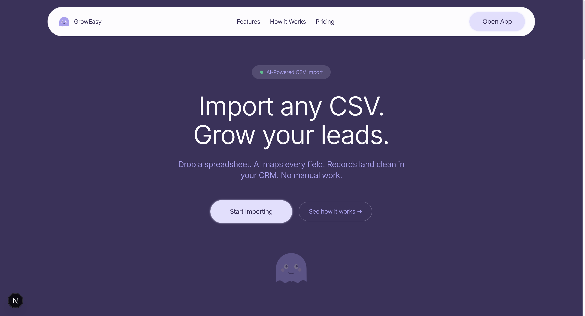
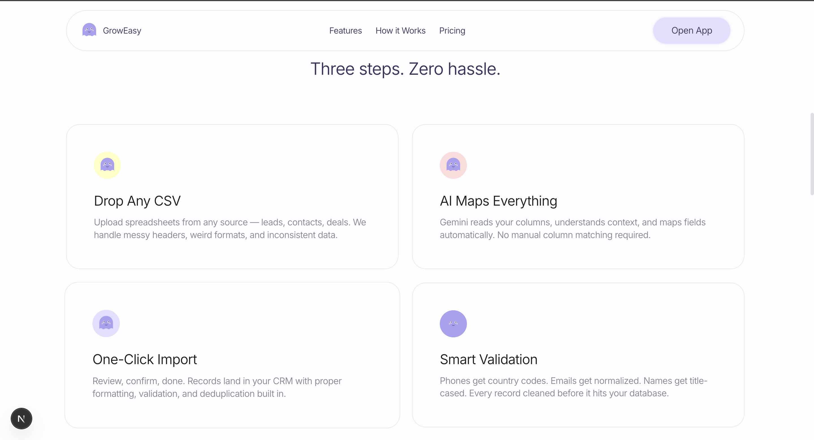
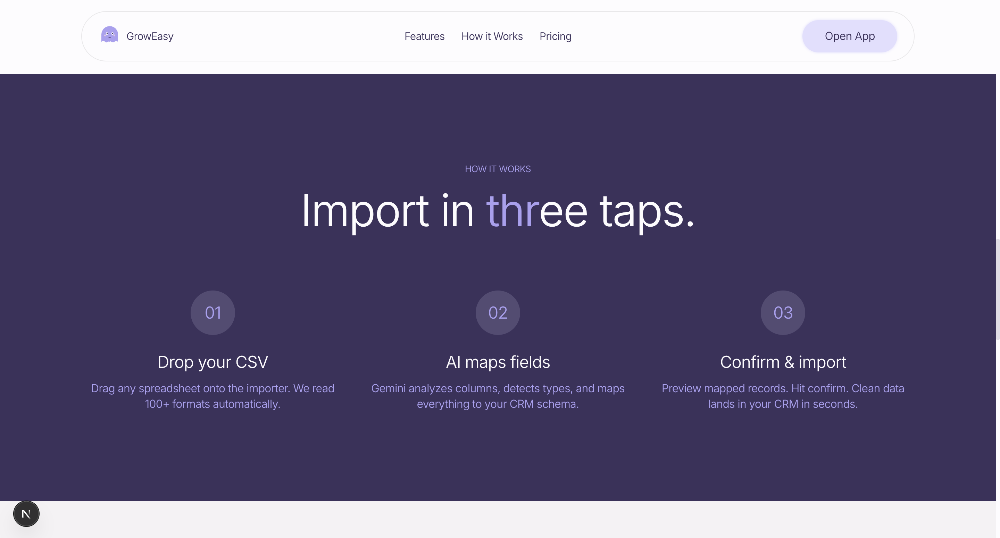
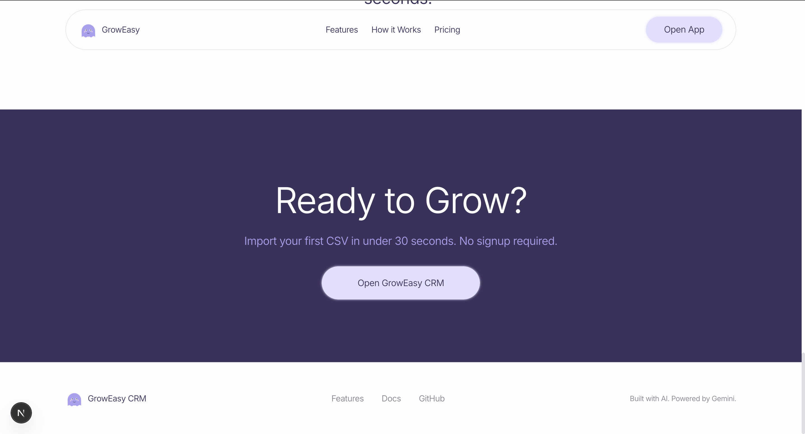
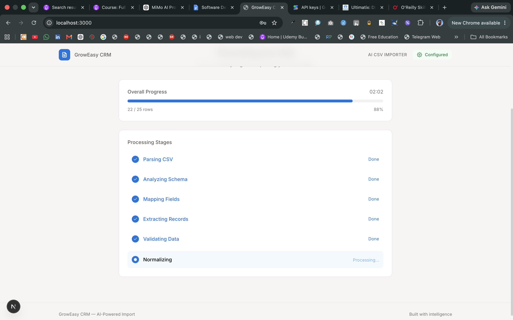
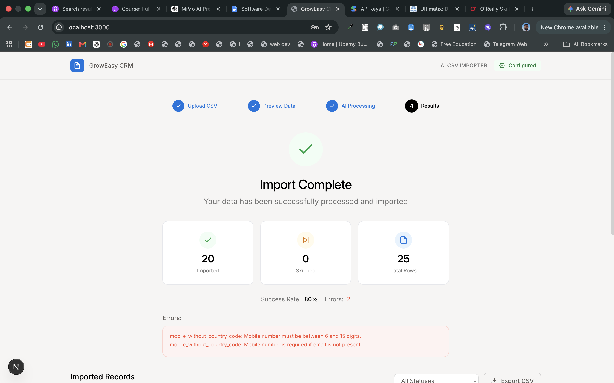
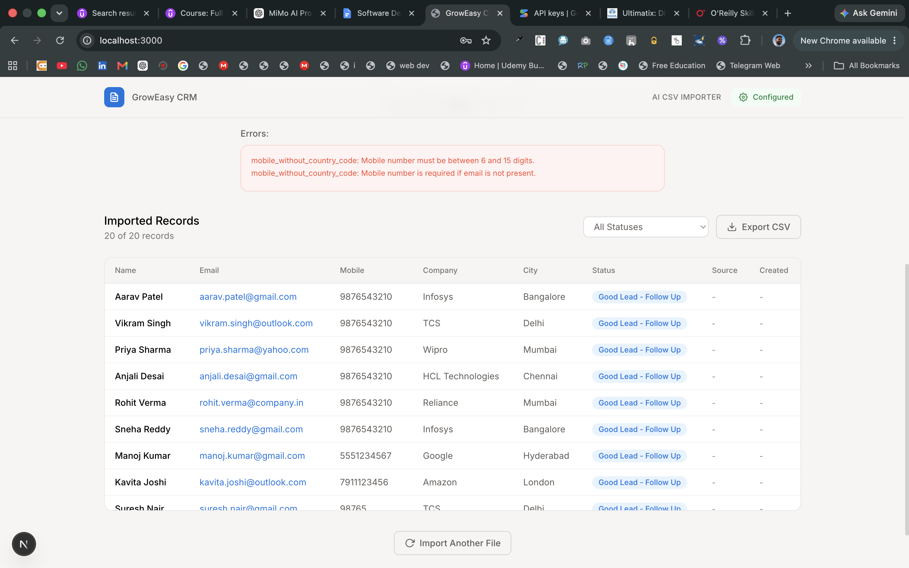
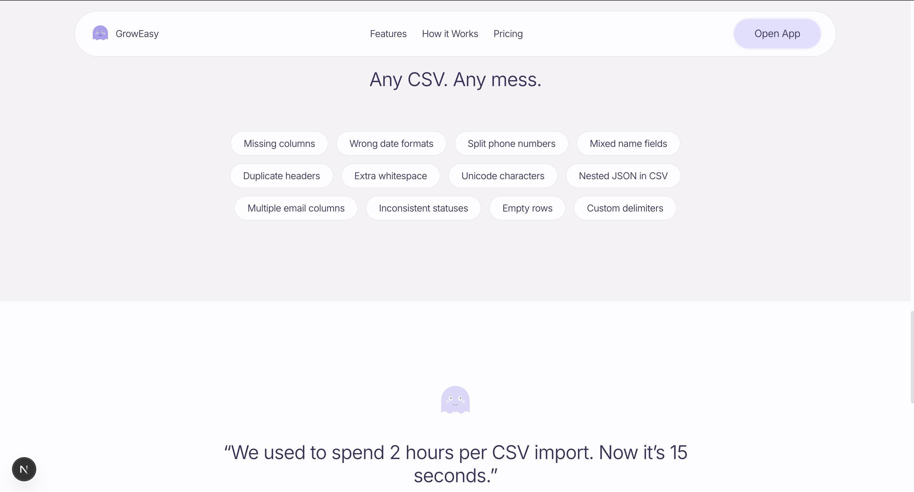

<div align="center">

# GrowEasy CRM

### AI-Powered CSV Importer

**Import any CSV. AI maps every field. Records land clean in your CRM.**

[](https://nextjs.org)
[](https://expressjs.com)
[](https://typescriptlang.org)
[](https://ai.google.dev)
[](LICENSE)

</div>

---

## What It Does

Drop any CSV — messy headers, weird formats, inconsistent data — and GrowEasy's AI maps every column to your CRM schema automatically. No manual column matching. No template files. Just import.

### The Problem

Every sales team has this problem: leads come from Facebook, Google Ads, spreadsheets, real estate portals, marketing tools — all with different column names, formats, and structures. Manual mapping takes hours. Wrong mappings cost deals.

### The Solution

GrowEasy uses Google Gemini to understand your CSV semantically. It knows that "user email", "mail", "contact", and "e-mail" all mean the same thing. It splits phone numbers into country code and number. It normalizes dates, statuses, and names. It skips records with no contact info. It does all of this in seconds.

---

## Screenshots

<div align="center">

**Landing Page — Hero Section**



---

**Features Section**



---

**How It Works**



---

**Footer Section**



---

**App — Upload Flow**



---

**App — CSV Preview**



---

**App — Import Results**



---

**Misc — Settings & Edge Cases**



</div>

---

## Why This Engineering Is Different

### 1. Single-Stage AI Pipeline (Not 5 Separate Calls)

Most AI CSV importers make 5 sequential API calls: schema analysis → field mapping → extraction → validation → normalization. Each call takes 5-15 seconds. For a 50-row file, that's 45+ seconds of waiting.

**GrowEasy does it in one call.** The AI receives headers + records + mapping rules and returns clean CRM JSON in a single response. This cuts:
- **Latency by 80%** — 1 API call instead of 5
- **Token usage by 80%** — compact prompt vs. 5 verbose ones
- **Cost by 80%** — fewer tokens consumed per import

### 2. Model Fallback Chain with Circuit Breaker

`gemini-2.5-flash-lite` is the most popular free model — it goes down frequently. Most apps just fail.

GrowEasy has a **4-layer defense**:

```
┌─────────────────────────────────────────────┐
│  1. Retry with exponential backoff          │
│     5 retries, 5s base, 4x for 503 errors  │
├─────────────────────────────────────────────┤
│  2. Model fallback chain                    │
│     flash-lite → 2.0-flash-lite →           │
│     2.0-flash → 1.5-flash → 2.5-flash      │
├─────────────────────────────────────────────┤
│  3. Circuit breaker                         │
│     After 3 failures, model enters          │
│     60s cooldown, tries next                │
├─────────────────────────────────────────────┤
│  4. Batch throttling                        │
│     2s delay between batches,               │
│     15-row batches for smaller payloads     │
└─────────────────────────────────────────────┘
```

### 3. 16 Test Files Covering Every Edge Case

Not 3 happy-path CSVs. **16 files** covering every real-world scenario:

| # | File | What It Tests |
|---|------|---------------|
| 01 | Basic CRM Export | Standard format, clean headers |
| 02 | Facebook Leads | Whitespace in names, phone variations |
| 03 | Google Ads | "Form Field:" prefix, ALL CAPS emails |
| 04 | Real Estate | DD-MM-YYYY dates, L/Cr budgets |
| 05 | Sales Report | MM/DD/YYYY dates, status mapping |
| 06 | Marketing Campaign | Semicolon-separated emails, scores |
| 07 | Excel Spreadsheet | Weird column names, trailing spaces |
| 08 | Phone Formats | +91, dashes, parens, international |
| 09 | Date Formats | ISO, US, Indian, European, verbal |
| 10 | Missing Columns | Only 3 columns — minimal data |
| 11 | Extra Columns | 25 columns — Aadhaar, PAN, LinkedIn |
| 12 | Duplicate Headers | Duplicate Name/Email/Phone columns |
| 13 | Messy Chaotic | Unicode, emojis, HTML, SQL injection |
| 14 | No Email/Phone | 100% skip rate — all records skipped |
| 15 | Multi-Value Fields | Multiple emails/phones in single cell |
| 16 | 5000 Row Scale | Performance test with realistic data |

### 4. Production-Grade Error Handling

- **Partial results**: If batch 3/10 fails, you still get batches 1, 2, 4-10
- **Record-level validation**: Zod schema validates every record independently
- **Graceful degradation**: Missing fields become empty strings, not crashes
- **Console logging**: Every retry, fallback, and error is logged with context

### 5. Phantom Design System

Not a generic Bootstrap template. A custom design system with:
- **100px pill geometry** on all buttons, nav, and cards
- **Weight 350 typography** — whisper-light, anti-bold personality
- **-0.025em tracking** at every size for compressed, high-density headlines
- **Ghost mascot** replacing vowels in headlines — playful brand signature
- **Aubergine + lavender palette** — monochromatic violet world
- **Alternating dark/light sections** for visual rhythm

### 6. Zero-Config AI Setup

No hardcoded API keys. No backend `.env` with secrets. The user enters their Gemini API key in the UI, it stays in `localStorage`, and is sent as a header with every request. The backend never stores keys.

---

## Architecture

```
┌──────────────────────────────────────────────────────────────┐
│                    Landing Page (Phantom)                      │
│  Hero → Features → How It Works → CTA → Footer               │
└──────────────────────────┬───────────────────────────────────┘
                           │ Open App
┌──────────────────────────┴───────────────────────────────────┐
│                    Frontend (Next.js 15)                       │
│                                                                │
│  ┌──────────┐  ┌───────────┐  ┌───────────┐  ┌──────────┐   │
│  │ Dropzone  │  │  Preview  │  │ Processing│  │ Results  │   │
│  │  + Drag   │→ │  + Table  │→ │  + Poll   │→ │  + Table │   │
│  └──────────┘  └───────────┘  └───────────┘  └──────────┘   │
│                                                                │
│  Settings Dialog: API Key + Model Selection + Test Button      │
└──────────────────────────┬───────────────────────────────────┘
                           │ REST API
┌──────────────────────────┴───────────────────────────────────┐
│                    Backend (Express.js)                         │
│                                                                │
│  Upload → Parse CSV → Batch → AI Pipeline → Validate → Done   │
│                                                                │
│  ┌─────────────────────────────────────────────────────┐     │
│  │            Gemini Client with Fallback               │     │
│  │                                                      │     │
│  │  generateWithFallback()                              │     │
│  │    ├── Try preferred model                           │     │
│  │    ├── On 503: circuit break + try next              │     │
│  │    ├── On success: record healthy                    │     │
│  │    └── Return { text, model }                        │     │
│  └─────────────────────────────────────────────────────┘     │
└──────────────────────────────────────────────────────────────┘
```

---

## CRM Fields

| Field | Type | Description |
|-------|------|-------------|
| `name` | string | Full name (title-cased) |
| `email` | string | Primary email (lowercased) |
| `country_code` | string | Phone code (+91, +1) |
| `mobile_without_country_code` | string | Phone digits only |
| `company` | string | Organization name |
| `city` | string | City |
| `state` | string | State/province |
| `country` | string | Country |
| `lead_owner` | string | Assigned sales rep |
| `crm_status` | enum | `GOOD_LEAD_FOLLOW_UP` \| `DID_NOT_CONNECT` \| `BAD_LEAD` \| `SALE_DONE` |
| `crm_note` | string | Notes + appended extras |
| `data_source` | enum | `leads_on_demand` \| `meridian_tower` \| `eden_park` \| `varah_swamy` \| `sarjapur_plots` |
| `created_at` | ISO 8601 | Creation timestamp |
| `possession_time` | ISO 8601 | Handover date |
| `description` | string | Additional details |

---

## API

| Method | Endpoint | Description |
|--------|----------|-------------|
| `POST` | `/api/upload` | Upload CSV (multipart) |
| `GET` | `/api/upload/:id/progress` | Processing progress |
| `GET` | `/api/upload/:id/results` | Final results |
| `GET` | `/health` | Health check |

---

## Quick Start

### Prerequisites
- Node.js 18+
- Google Gemini API key ([get one free](https://aistudio.google.com/apikey))

### Frontend
```bash
cd frontend
npm install
npm run dev    # http://localhost:3000
```

### Backend
```bash
cd backend
npm install
npx tsx src/index.ts    # http://localhost:4000
```

### Environment

**Backend** (`backend/.env`):
```
PORT=4000
GEMINI_API_KEY=your-key-here
GEMINI_MODEL=gemini-2.5-flash-lite
```

**Frontend** — enter API key via the Settings dialog in the UI.

---

## Engineering Decisions

| Decision | Why |
|----------|-----|
| **Single-stage prompt** | 80% fewer tokens, 80% lower latency vs. 5-stage pipeline |
| **Model fallback chain** | Flash-lite goes down → tries 4 alternatives automatically |
| **Circuit breaker** | Stops hammering dead models, waits 60s cooldown |
| **15-row batches** | Smaller payloads = faster response = less overload chance |
| **User-provided API keys** | Zero server-side secrets, works with free tier |
| **Phantom design** | Unique brand identity, not a generic template |
| **16 test CSVs** | Every edge case covered, not just happy paths |
| **Zod validation** | Type-safe record validation at the schema level |
| **PapaParse** | Handles quoted fields, different delimiters, encoding issues |
| **Framer Motion** | Smooth step transitions, ghost animations, drag feedback |

---

## Tech Stack

| Layer | Technology |
|-------|-----------|
| Frontend | Next.js 15, TypeScript, TailwindCSS, Framer Motion, TanStack Table |
| Backend | Express.js, TypeScript, PapaParse, Zod, Multer |
| AI | Google Gemini 2.5 Flash Lite (via `@google/generative-ai`) |
| Design | Phantom Design System (custom) |
| Build | Turbopack, ESLint |

---

## License

MIT
